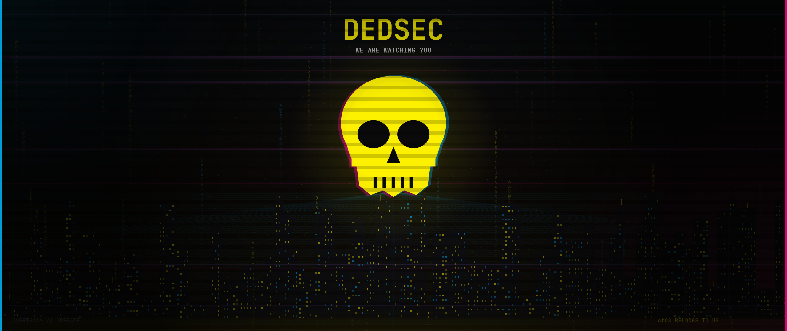

# omarchy-dedsec-theme

Watch Dogs 2–inspired **DedSec** theme for [Omarchy](https://omarchy.org) — yellow invite, cyan network, pink glitch, terminal black.



> Fan-made / unofficial. DedSec and Watch Dogs are trademarks of their respective owners. Not affiliated with Ubisoft.

## Palette

| Token | Hex |
|-------|-----|
| Accent / yellow | `#FDF001` |
| Cyan | `#00AEEF` |
| Glitch pink | `#EC008C` |
| Background | `#0a0a0a` |

## Wallpapers (2560×1080)

| File | Mood |
|------|------|
| `backgrounds/01-dedsec-hero.png` | Skull + city skyline + binary rain |
| `backgrounds/02-ctos-offline.png` | Grid / ctOS offline |
| `backgrounds/03-invite.png` | Follow the invite |

## Install

```bash
omarchy-theme-install https://github.com/NostrDanish/omarchy-dedsec-theme.git
```

Or:

```bash
omarchy theme install https://github.com/NostrDanish/omarchy-dedsec-theme.git
```

Then cycle wallpapers:

```bash
omarchy theme bg next
```

## Regenerate wallpapers

```bash
python3 gen_wallpapers.py   # needs pycairo
```

## License

MIT — see `LICENSE`.
